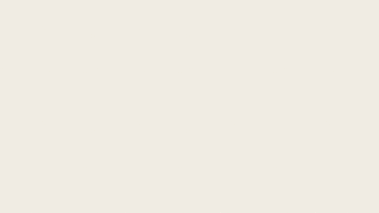
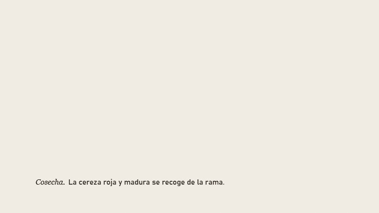
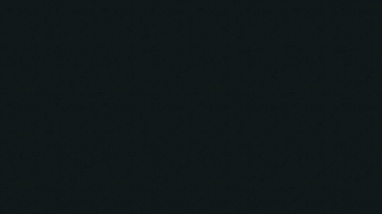
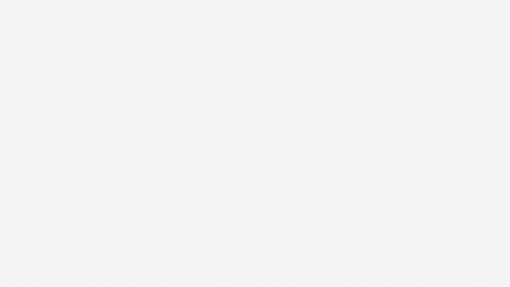
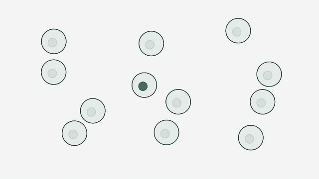
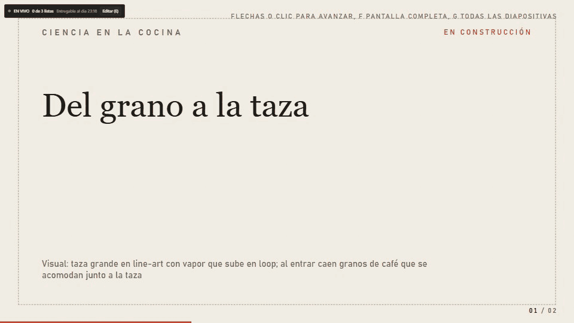
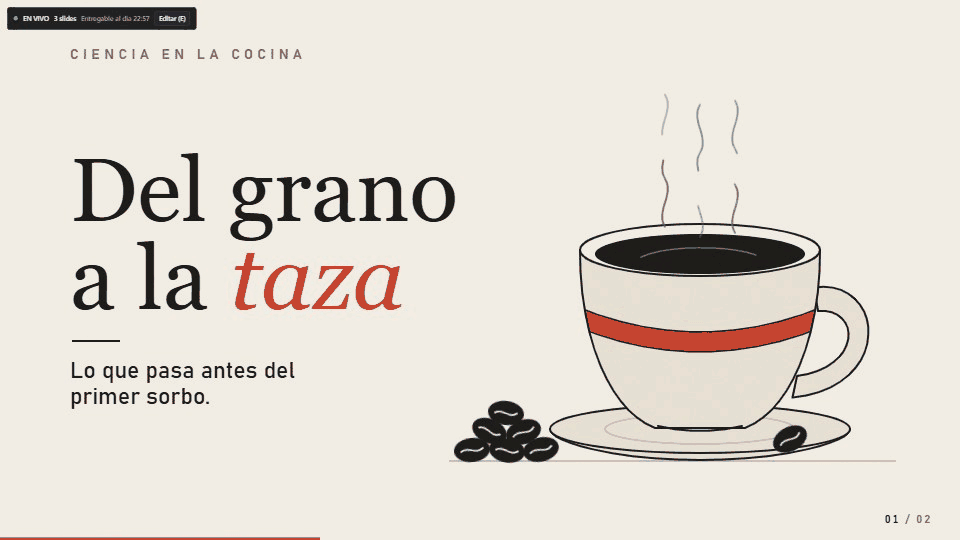
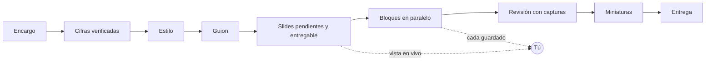

<p align="center">
  
</p>

<p align="center">
  <b>Le dices el tema y te entrega una presentación en un solo HTML, con ilustraciones animadas, que pasas con las flechas.</b>
</p>

## Qué es

`presentaciones-motion` es una skill para Claude Code. Le pides una presentación (tema, público, duración) y arma
el guion, verifica las cifras en fuentes reales, elige un estilo que le quede al tema y construye las slides en
paralelo. Mientras trabaja ves el avance en vivo, y el HTML que vas a entregar existe desde el primer minuto y se
actualiza con cada slide que queda lista.

Sirve para una clase, una charla, una propuesta de negocio o un taller. Cada slide lleva una ilustración animada
que explica la idea (SVG, CSS o canvas): lo que se mueve es el dibujo, no el texto. Entre secciones hay
transiciones de puro movimiento, y los procesos se explican paso a paso: cada flecha avanza un paso y también se
puede retroceder.

## Así se ve

Tres presentaciones de ejemplo, cada una en el estilo que le queda a su tema. Todas salieron de esta skill.

<table>
  <tr>
    <td width="50%"></td>
    <td width="50%"></td>
  </tr>
  <tr>
    <td colspan="2"><b>Estilo Papel.</b> Una clase de cocina: portada ilustrada y el recorrido del grano a la taza, un paso por flecha.</td>
  </tr>
  <tr>
    <td></td>
    <td></td>
  </tr>
  <tr>
    <td colspan="2"><b>Estilo Plano técnico.</b> Cómo llega la luz a tu casa: un diagrama con energía que circula y la tensión que baja por etapas.</td>
  </tr>
  <tr>
    <td></td>
    <td></td>
  </tr>
  <tr>
    <td colspan="2"><b>Estilo Clínico.</b> Divulgación de salud: una ilustración conceptual por pasos y una gráfica que se dibuja sola.</td>
  </tr>
  <tr>
    <td></td>
    <td></td>
  </tr>
  <tr>
    <td colspan="2"><b>Interstitials.</b> Transiciones de puro movimiento entre secciones, sin texto.</td>
  </tr>
</table>

## Vista en vivo y editor tipo PowerPoint

<p align="center">
  
</p>

Mientras se construye, la presentación se abre en tu navegador desde un servidor local y se recarga sola con cada
cambio, en la misma slide donde estabas. Las slides que faltan aparecen como "EN CONSTRUCCIÓN" desde el principio,
así ves el plan completo y lo corriges antes de que esté terminado.

<p align="center">
  
</p>

Con la tecla **E** se abre el editor: panel de slides con miniaturas, cinta de herramientas y panel de propiedades.

- Seleccionar uno o varios elementos, moverlos con guías, escalar y rotar con manijas.
- Alinear y distribuir, traer al frente o enviar al fondo.
- Copiar, cortar, pegar y duplicar, también entre slides.
- Insertar texto, rectángulos, círculos, líneas e imágenes (desde archivo, pegadas o arrastradas).
- Cambiar color, tamaño de letra, negrita, cursiva, opacidad y capas.
- Deshacer y rehacer. Al guardar (Ctrl+S) todo queda en los archivos fuente, con respaldo y "Deshacer guardado".

## Qué incluye

- **Un solo archivo.** Fuentes e imágenes van adentro: funciona sin internet y abre en cualquier navegador. Para
  compartir la presentación basta mandar el `.html`.
- **Hecho para presentar.** Flechas, espacio o clic para avanzar; **F** pantalla completa; **B** pantalla negra;
  **G** galería de miniaturas para saltar a cualquier slide.
- **Escenario fijo de 1920 x 1080** que se escala a cualquier pantalla o proyector.
- **Un estilo para cada tema.** Siete estilos con contraste revisado (Papel, Plano técnico, Clínico, Corporativo,
  Pizarra, Atardecer y Cartel) o la paleta de tu marca o tu escuela.
- **Entregable siempre al día.** El HTML final existe desde el inicio y se reescribe con cada avance.
- **Exporta a PDF y PowerPoint.** Cada slide sale como imagen fiel al diseño; las animaciones se quedan en el HTML.
- **Se revisa sola.** Captura cada slide con Edge o Chrome sin ventana, recorre la navegación hacia adelante y
  hacia atrás y cuenta los errores de JavaScript. Después de una corrección solo vuelve a capturar lo que cambió.
- **Reglas de contenido.** Cifras verificadas y con su fuente en la slide, poco texto, una idea por slide, y los
  temas delicados (salud, finanzas, seguridad) como divulgación, nunca como instructivo.

## Cómo trabaja



1. **Encargo.** Tema, público, duración y tono. Si ya tienes la lista de temas, la respeta en su orden.
2. **Cifras.** Cada número que va a pantalla se verifica en la web y se anota con su fuente.
3. **Estilo.** Elige paleta y fuentes según el tema, el público y el lugar donde se va a presentar.
4. **Guion.** Slides agrupadas en bloques de 4 a 6, con el visual de cada una.
5. **Esqueleto.** Crea todas las slides como pendientes, escribe el HTML entregable y abre la vista en vivo.
6. **Bloques en paralelo.** Cada bloque lo construye un agente distinto; cada slide terminada reemplaza a su
   pendiente en la vista y en el entregable.
7. **Revisión.** Capturas de cada slide, cada paso y la navegación completa.
8. **Entrega.** Miniaturas de la galería y comprobación final: sin pendientes, sin avisos y sin errores.

## Requisitos

- Claude Code (app de escritorio o terminal).
- Python 3.10 o más nuevo, con Pillow.
- Node.js 22 o más nuevo.
- Microsoft Edge o Google Chrome.
- Windows 10 u 11 para la fuente de cuerpo por defecto, Bahnschrift, que viene con Windows y no se incluye aquí.
  En Mac o Linux la skill la cambia por una fuente libre.

## Instalación

```bash
git clone https://github.com/MarioUrenaGarcia/presentaciones-motion.git ~/.claude/skills/presentaciones-motion
pip install pillow
```

En Windows con PowerShell:

```powershell
git clone https://github.com/MarioUrenaGarcia/presentaciones-motion.git "$env:USERPROFILE\.claude\skills\presentaciones-motion"
pip install pillow
```

Reinicia Claude Code. Para actualizar a la última versión:

```bash
git -C ~/.claude/skills/presentaciones-motion pull
```

## Úsala

Pídele algo como:

- "Una clase de 10 slides sobre el ciclo del agua para niños de primaria."
- "Una charla de 15 minutos sobre finanzas personales para estudiantes universitarios."
- "La presentación de resultados del trimestre con los colores de mi empresa: azul #1f4e9c y gris."
- "Agrega una slide que explique paso a paso cómo se hace una transferencia bancaria."
- "Exporta la presentación a PDF y PowerPoint."

Te muestra el guion, abre la vista en vivo y te da la ruta del HTML. Al terminar te dice cuántas slides tiene, qué
se verificó y qué no.

## Estructura

```
SKILL.md                  flujo completo y reglas
references/brief.md       instrucciones para quien construye cada bloque
references/motor.md       API del motor de slides
references/estilos.md     estilos y reglas de color
assets/shell.html         motor: escenario, navegación, pasos y galería
assets/vivo/cliente.js    vista en vivo y editor
assets/ejemplos/          bloques de ejemplo: portada ilustrada, diagramas, pasos y gráficas
assets/fonts/             Bebas Neue y su licencia
scripts/build.py          arma el HTML de un solo archivo
scripts/esqueleto.py      slides pendientes a partir del guion
scripts/vivo.py           servidor local de la vista en vivo y el editor
scripts/shot.mjs          capturas con Edge o Chrome sin ventana
scripts/hoja.py           hojas de contacto para revisar varias capturas a la vez
scripts/nav.mjs           prueba la navegación hacia adelante y hacia atrás
scripts/recorrido.mjs     recorre el deck como el presentador
scripts/miniaturas.py     miniaturas de la galería
scripts/exportar.py       PDF y PowerPoint
scripts/cdp.mjs           control del navegador para capturas y pruebas
docs/                     imágenes de este README
```

## Seguridad

- El servidor de la vista en vivo escucha solo en `127.0.0.1` y pide un token para guardar.
- El HTML no carga nada de internet.

## Licencia

El código está bajo la licencia MIT (`LICENSE`). Bebas Neue, de Dharma Type, se distribuye bajo la SIL Open Font
License 1.1 (`assets/fonts/OFL-BebasNeue.txt`). Bahnschrift es de Microsoft y no se incluye.
